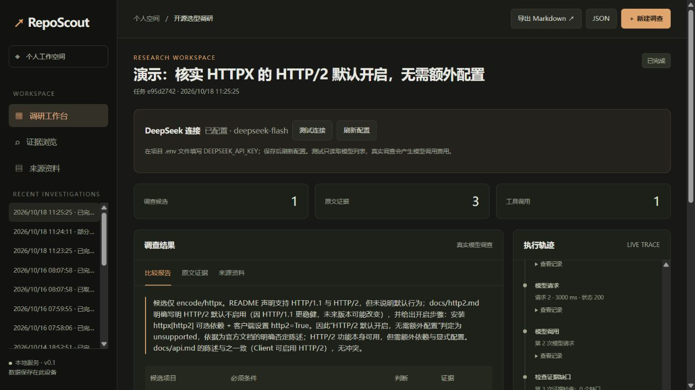

# RepoScout

**让开源选型判断有可核查的原文依据。**

输入候选 GitHub 仓库与需求，Agent 按需读取 README、仓库文档、Release 和 Issue，输出支持 / 不支持 / 未知 / 冲突矩阵，保留来源、执行轨迹和预算记录。

这是可本地演示的个人 Agent 项目；源码已公开，应用未部署公网。



[最新收尾验收](docs/closeout-results.md) · [三段演示](docs/demo/closeout-walkthrough.md) · [面试说明](docs/interview-guide.md) · [架构](docs/architecture.md) · [CI](https://github.com/Huhuhuc/RepoScout/actions)

## 运行

需要 Python 3.11+。Windows 双击 `start-reposcout.bat`，打开 http://127.0.0.1:8011 。首次安装依赖，已有 `.env` 不会覆盖。

手动启动：

```powershell
python -m venv .venv
.\.venv\Scripts\python.exe -m pip install -r requirements.lock.txt
.\.venv\Scripts\python.exe -m uvicorn reposcout.app:app --host 127.0.0.1 --port 8011
```

Windows 自检：`powershell -ExecutionPolicy Bypass -File .\start-reposcout.ps1 -Check`。端口占用可加 `-Port 8012`。Linux/macOS 提供 `bash start-reposcout.sh`；CI 覆盖 Linux/Windows 的 Python 测试，macOS 启动器未实机验收。

## 三种模式

| 模式 | 数据来源 | 行为 |
|---|---|---|
| demo | 内置虚构资料 | 无需密钥，规则演示流程 |
| github | 真实 GitHub 资料 | 只采集，功能判断保持未知 |
| deepseek | 真实 GitHub 资料 | 模型调用工具、保存证据、补查并提交报告 |

首次运行建议先用 demo。真实模式建议填写明确仓库（如 `encode/httpx`），最多 3 个候选、8 个条件。复杂中文需求的候选发现仍有限。

## DeepSeek 配置

复制 `.env.example` 为 `.env`，本地填写：

```dotenv
DEEPSEEK_API_KEY=你的密钥
DEEPSEEK_MODEL=deepseek-flash
```

页面点击“刷新配置”和“测试连接”。测试只请求官方模型列表，不生成回答；所选模型需在账户可用列表中。真实调查调用模型会产生费用。配置热读取，进程环境变量优先，已运行任务继续用启动时配置。API 密钥不返回前端，不提交到 Git。

可选 `GITHUB_TOKEN` 使用进程环境变量。模型服务固定为官方 DeepSeek，目前不支持自定义网关。

## 调查策略与可靠性

- **自动策略**：对明确候选、最多三个条件的新任务先读取 README，用一次结构化调用尝试完成取证和矩阵；未知、限制条件或参数问题会升级调查。工作台默认自动，API 默认 `strategy=deep`，可显式指定 `strategy=auto`。
- **深入策略**：模型选择读取与补查工具，最多两轮定向补查；继续已有任务直接进入深入流程。
- **原文片段选择**：模型可选择 `span_id`，服务端验证来源、位置和长度后截取原文，避免复制 Markdown 时丢失格式。也保留严格匹配的 `quote` 接口；不接受改写或模糊匹配。
- **证据约束**：确定性判断需有同候选、同需求证据；资料未提及不能直接判不支持，社区 Issue 不能单独支撑确定性功能结论。
- **有界运行**：最多 12 次模型网络请求（含重试）、60 次资料请求、5 分钟；Token 预算是保守预估控制，不是供应商账单硬上限。
- **恢复与审计**：SQLite 保存历史、事件与检查点；失败或预算耗尽保留部分报告。继续调查创建关联新任务、复用资料并使用新预算，旧任务不被改成成功。
- **可选复核**：同一模型用独立提示检查摘录是否支持判断；失败或不足会标记。它不是独立模型事实核验，也不保证语义正确。

## 资料范围

README 与仓库文档固定 commit，保存 URL、抓取时间和内容哈希。每个候选最多扫描四个目录、读取三篇文档、三个 Release 和三个 Issues。Issue 暂不采集评论。

外部官方文档只读取当前仓库资料明确链接的受支持站点：docs.langchain.com、python.langchain.com、docs.llamaindex.ai、docs.haystack.deepset.ai、docs.n8n.io、docs.dify.ai。限 HTTPS 文本、1 MB、不跟随重定向，不传模型/GitHub 密钥；外部页面版本未固定。无结果、拒绝读取与资料截断都会影响覆盖，不能证明功能不存在。

## 运行测试与评测

```powershell
.\.venv\Scripts\python.exe -m unittest discover -s tests -v
.\.venv\Scripts\python.exe -m evals.validate_dataset evals/multi-repo-cases.json
.\.venv\Scripts\python.exe -m scripts.closeout_demo
```

79 项自动测试通过。默认演示命令在临时数据库里验证取消、检查点恢复和导出，不调用模型、不改个人任务。

12 个真实冻结资料任务来自 HTTPX、Pydantic、FastAPI 三个仓库，四策略对照的原始结果、失败案例和成本见 [收尾验收](docs/closeout-results.md)。标签由编码助手依据原文整理，未由独立标注者复核；它不是大规模准确率基准。工程测试通过与模型判断正确是不同指标。

```powershell
# 以下命令显式调用模型并产生费用，结果另存；默认不覆盖旧文件
.\.venv\Scripts\python.exe -m evals.compare --dataset evals/multi-repo-cases.json --max-cases 12 --repeats 1 --live --output evals/results/my-comparison.json
```

中断后，在代码、资料、模型与参数不变时加 `--resume`，只补缺失策略。保留历史结果，不挑选成功样例覆盖失败记录。

## 演示与边界

[实时支持判断报告](examples/closeout-supported.md) · [实时恢复后报告](examples/closeout-recovered.md) · [录屏讲解顺序与命令](docs/demo/closeout-walkthrough.md)

本地单用户应用，无登录、多租户或公网部署能力，请保持绑定 `127.0.0.1`。当前没有全网搜索、多 Agent、向量检索或自主执行第三方代码；并非所有任务都能在预算内完成。项目尚未选择主项目开源许可证；引用资料的上游许可证保存在 `evals/licenses/`。

## 学习来源

- [GPT Researcher](https://github.com/assafelovic/gpt-researcher)：调研、来源与报告分层。
- [Local Deep Researcher](https://github.com/langchain-ai/local-deep-researcher)：迭代研究循环。
- [GitHub REST 文档](https://docs.github.com/en/rest)：仓库读取与限流。

本项目主体独立编写；界面布局参考说明见 [workspace-references](docs/workspace-references.md)。历史实验保留在 `evals/results/` 与 `docs/` 中，旧版本记录不代表当前版本测试结果。
