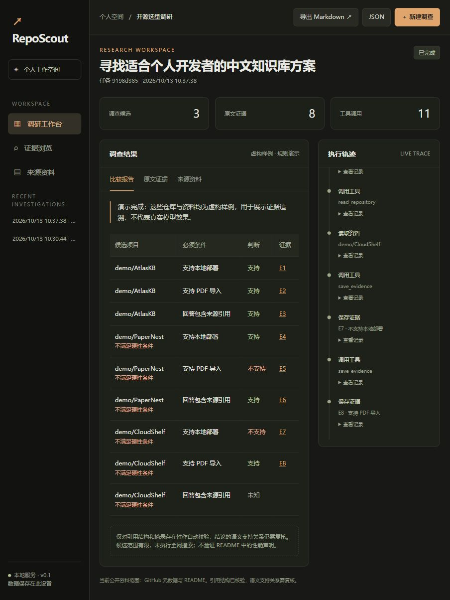

# RepoScout

**让开源选型的每个判断都有原文依据。**

输入需求与最多三个候选仓库，保存调查轨迹、资料和证据，生成比较矩阵。中文工作台采用黑灰与暖橙配色。



布局借鉴成熟工具的工作区与工具轨迹分层，详见 [参考说明](docs/workspace-references.md)。

## 运行

Windows 双击 `start-reposcout.bat`，首次安装依赖后打开 http://127.0.0.1:8011 。需要 Python 3.10+。

```powershell
python -m venv .venv
.\.venv\Scripts\python.exe -m pip install -r requirements.txt
.\.venv\Scripts\python.exe -m uvicorn reposcout.app:app --host 127.0.0.1 --port 8011
```

先选择演示模式，使用默认的本地部署、PDF、引用三个条件。示例仓库全部虚构，规则策略确定比较结果；它不模拟真实模型研究质量。

## 三种模式

| 模式 | 数据 | 决策 |
|---|---|---|
| demo | 内置虚构快照 | 明确限定的规则，测试流程 |
| github | 真实 GitHub 元数据与 README | 只采集，功能判断为未知 |
| deepseek | 真实 GitHub 元数据与 README | 模型动态选工具并提交结构化报告 |

GitHub 模式建议输入明确仓库，例如 `langchain-ai/local-deep-researcher`。无候选时直接将问题用作 GitHub 查询；复杂中文查询质量有限。实际模型模式尚未调用验证。

可选配置在启动前设置环境变量：

```powershell
$env:DEEPSEEK_API_KEY = '<在本机填写>'
$env:GITHUB_TOKEN = '<可选的 GitHub 公共资料访问令牌>'
```

密钥不传给浏览器，也不写入任务。`.env.example` 是说明模板，当前不自动读取 `.env`。

## 当前实现

- Requirement / Source / Evidence / Assessment 四类数据。
- 摘录必须属于来源原文，证据必须关联同一候选与需求。
- 支持、不支持、未知、冲突；违反硬性条件的候选列为 excluded。
- 单 Agent 工具调用循环，模型参数本地校验。
- SQLite 历史任务、执行事件、取消、重启中断标记。
- 工具预算、60 次网络请求上限、12 次模型调用上限、5 分钟任务上限。
- SSE 进度、证据查看、Markdown/JSON 导出。

## 明确的边界

第一版没有全网搜索、任意网页读取、Release/Issue 调查、语义引用审判、多 Agent、自动恢复或向量检索。GitHub HTTP 只允许固定 API 域名且不跟随重定向。报告的引用结构校验不能证明结论语义正确。采集模式不从 README 关键词推断真实能力。DeepSeek 默认兼容接口需真实调用验证。

这是本地单用户原型，无登录、多租户与公网部署能力。保持绑定 127.0.0.1。README 长度和下载大小有限；报告保存抓取时间、ref 和哈希，源正文可能截断。

## 验证

```powershell
.\.venv\Scripts\python.exe -m unittest discover -s tests -v
```

后续加入至少 12 个冻结评测任务、基线与消融，真实模型质量指标只根据实际实验填写。

## 学习来源

- [GPT Researcher](https://github.com/assafelovic/gpt-researcher)：调研、来源与报告分层。
- [Local Deep Researcher](https://github.com/langchain-ai/local-deep-researcher)：迭代研究循环。
- [GitHub REST 文档](https://docs.github.com/en/rest)：公开仓库读取与限流。

本版独立编写，未复制上游源码。调研结论位于工作区 docs/2026-10-13-RepoScout开源调研与改进路线.md。
