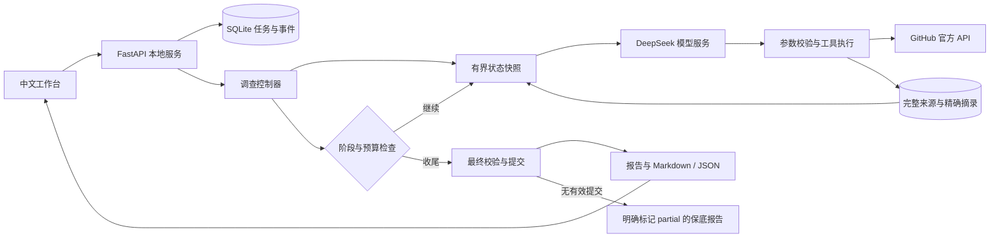

# RepoScout 架构

## 核心边界

- `provider.py` 只管理密钥、官方接口、请求重试、耗时和 Token 统计。
- `orchestrator.py` 管理调查/收尾两阶段，最多 12 次模型网络请求；达到第 8 次请求、工具预算余量不足、三轮无进展或完成补查时，停止扩展调查。最后两次请求只允许提交。
- `context.py` 从本地完整资料生成片段和当前矩阵快照，不累计发送完整历史。默认来源正文片段合计不超过 10,000 字符，可通过 `read_source` 按关键词或偏移继续读取。
- `tools.py` 校验工具参数、精确摘录、工具预算，缓存本任务相同的只读查询。命中缓存仍占工具预算，避免空转。
- `research.py` 保存矩阵变化与补查轨迹；提交时由程序执行最终复查，不再要求模型重复调用检查。
- `evals/` 提供冻结的合成资料与隐藏答案、模型对照运行器、独立评分器。外部资料网络请求被禁止，只有显式 `--live` 才会调用模型。

## 不夸大的保证

结构校验能拒绝伪造摘录、跨需求引用和没有明确依据类型的否定结论，但不是通用语义证明器。模型仍可能错误解释真实资料；冻结评测的匹配评分仅适用于该小型合成数据集。`partial` 不计作完整提交，不包装成成功。

取消和总时长检查在模型请求/工具边界执行；已发送的 HTTP 请求不能撤销其服务端费用。网络读超时不自动重发生成请求。没有登录/多租户，默认只监听 127.0.0.1。
