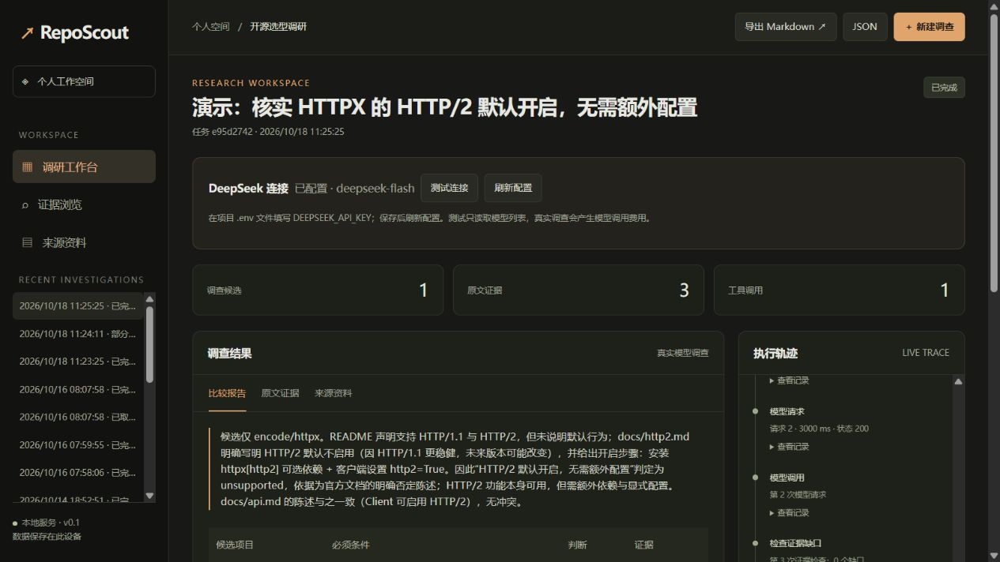

# RepoScout 收尾验收（2026-10-18）

当前版本可作为本地实习面试演示项目：真实资料采集、工具调用、证据矩阵、预算控制、部分报告、恢复与导出均有验证记录。它仍是单用户原型，不能据此宣称生产级可靠性。

## 本轮修改

- 模型选择原文 `span_id`，服务端按坐标截取并严格校验；保留原有精确 quote 接口，不接受模糊匹配。减少 Markdown 复制错误，不保证摘录在语义上足以支持结论。
- 评测逐策略保存，支持校验代码、数据、模型及参数后的断点继续；默认禁止覆盖已有结果。
- 完整评测发现 FastAPI README 中异常 URL 可触发 URL 解析异常，导致调查中断。现跳过无法解析的链接，并增加全部冻结 README 的上下文构建回归检查。
- 整理独立恢复演示、真实报告、面试说明与 CI 验证步骤。

## 12 个任务 × 4 种策略

模型：`deepseek-flash`。每个任务、每种策略运行一次，共 48 次；使用相同冻结资料池。结果来自 [完整原始记录](../evals/results/closeout-final-2026-10-18.json)。

| 策略 | 判断与标签一致 | 完成提交 | 严格证据评分通过 | 总 Token | 模型请求 | 总耗时（秒） |
|---|---:|---:|---:|---:|---:|---:|
| 同资料单次回答 | 9/12 | 12/12 | 6/12 | 77,354 | 12 | 29.72 |
| 禁用定向补查工具 | 10/12 | 12/12 | 8/12 | 325,261 | 89 | 192.36 |
| 深入调查 | 10/12 | 10/12 | 7/12 | 325,048 | 81 | 170.26 |
| 自动策略 | 12/12 | 12/12 | 11/12 | 298,408 | 70 | 147.57 |

本轮自动策略总 Token 比深入调查少约 8.2%，但为单次回答的约 3.86 倍，耗时约 4.97 倍。结果支持继续使用自动策略作为工作台默认选择，不能证明 Agent 普遍优于单次回答，也不能证明稳定节省成本。

严格评分同时要求正确状态、有效完成、引用精确和预设依据片段命中。自动策略的 FastAPI WebSocket 任务状态正确且引用精确，但没有命中预设依据片段，因此严格评分未通过。深入调查有两项未完成，另有 Pydantic strict 与 FastAPI background 判断不一致；失败均保留。单次回答引用精确率为 82.2%，三个 Agent 策略均为 100%，其中服务端片段截取是重要原因，这不等于模型语义正确率。

### 评测限制

- 仅 HTTPX、Pydantic、FastAPI 三个仓库的 README 与仓库文档，12 条单条件任务；未覆盖 Release、Issue、多候选或版本冲突。
- 标签及接受片段由编码助手整理，没有独立人工复核；接受片段列表不完备，可能漏掉合理依据。`citation_support` 是片段命中代理指标，不是人工语义正确率。
- 单次回答一次接收全部资料，Agent 按需读取同资料池；上下文呈现方式不同。Agent 可用原文坐标，基线直接生成引用，比较包含程序约束的收益。
- “禁用补查”仅禁用 `investigate_gaps`，并未禁用直接资料读取工具，因此不能把差异完全归因于自主补查。
- 本轮 `verify_claims=false`，不含可选语义复核；实际页面演示开启了复核。冻结运行限制为 16 次工具调用、60,000 Token 预算、最多 12 次模型请求。
- 每种策略仅运行一轮，未估计置信区间或稳定性。判断一致与完成率分别统计，避免 fallback unknown 被当成成功提交。

### 保留的第一次失败实验

[首次完整结果](../evals/results/closeout-2026-10-18.json) 包含上述 URL 解析异常。修复异常并将基线工具说明改为准确的“全部冻结资料”后，重新运行全部 48 次，未仅挑失败任务重测。两份记录保留各自代码哈希；首次结果不作为当前性能。

## 实际 GitHub / DeepSeek 演示

真实任务记录见 [API 验证](closeout-live-smoke.json) 与 [父子恢复记录](closeout-live-recovery.json)。

| 场景 | 结果 | Token | 模型请求 | GitHub HTTP |
|---|---|---:|---:|---:|
| HTTPX 同步与异步 API | completed / supported；快速结构化结果不合法后转深入 | 15,617 | 5 | 3 |
| HTTPX 是否默认启用 HTTP/2，首次调查 | partial / unknown；预算停止 | 37,629 | 6 | 11 |
| 上述任务继续调查 | completed / unsupported；复用资料 | 16,440 | 3 | 0 |

HTTP/2 父子任务合计 54,069 Token、9 次模型请求。不能仅用子任务成本代表完整调查成本；父任务仍保持 partial。最终结论引用仓库文档，浏览器已检查恢复后报告和导出入口。

- [支持判断报告](../examples/closeout-supported.md)
- [恢复后报告](../examples/closeout-recovered.md)
- [可重放的演示步骤](demo/closeout-walkthrough.md)：默认离线脚本不调用模型，真实场景需显式 `--live`。
- [简历与面试说明](interview-guide.md)

## 工程验收与边界

本地 79 项自动测试通过；另检查固定资料集、无付费离线恢复、Python 编译和 JavaScript 语法。Windows/Linux × Python 3.11/3.13 的最终云端状态以 [GitHub Actions](https://github.com/Huhuhuc/RepoScout/actions) 对应提交为准。

范围按本地面试项目收尾。后续真正值得补充的是独立人工标签、重复试验、更复杂的版本与多候选任务，以及更稳定的成本控制。当前没有登录、多租户或公网部署能力，未选择主项目许可证；无需为了简历堆入多 Agent 或向量库。
